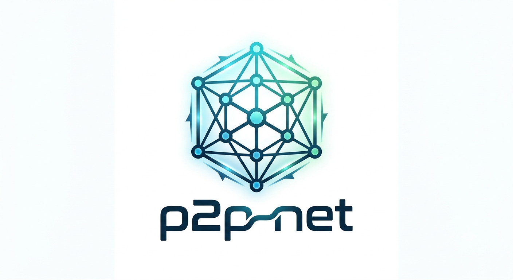

# p2p-net

<p align="center">
  
</p>

`p2p-net` is a Rust peer-to-peer node built on libp2p. It handles transports,
discovery, NAT traversal and relays for you. Your app sees six simple calls.

## How it works

1. Give every node of your app the same `network_id` and `discovery.namespace.app_id`.
2. Start the nodes. They find each other on the LAN, through the DHT and through
   public bootstrap peers, and connect directly or through relays.
3. Use the six API calls to send and receive messages.

You don't write any discovery, NAT or transport code.

## Features

- **Runs anywhere:** native (Windows, Linux, macOS, Android) and in the browser
  (WASM), with the same API.
- **Finds peers:** LAN discovery, Kademlia DHT, rendezvous, and public bootstrap
  fallback. No servers are required.
- **Connects through NAT:** relays, DCUtR hole punching, AutoNAT, and
  browser-to-browser WebRTC.
- **TURN:** run your own TURN node or use Cloudflare. Browsers get TURN
  credentials automatically.
- **Roles:** pick a `profile` (`full`, `lite`, `relay`, `turn`, …) and the node
  configures itself. Every setting can still be changed.
- **Safe defaults:** connection caps, replay protection, peer scoring, and
  authenticated messages.
- **Telemetry:** per-peer and per-topic bandwidth, storage and compute counters,
  plus Prometheus export and a terminal dashboard.

## Add to your project

```toml
[dependencies]
p2p-net = { git = "https://github.com/peavey2787/p2p-net" }
```

## The six API calls

```rust
use p2p_net::{start_node, NodeConfig};

let handle = start_node(NodeConfig::load_json_file("p2p-node.json")?).await?;

handle.connect_peer(addr).await?;                            // connect to a peer
handle.disconnect_peer(peer_id).await?;                      // disconnect
handle.send_message(peer_id, "chat/general", payload).await?; // send to one peer
handle.broadcast("game/lobby", payload).await?;              // send to a topic
let mut messages = handle.subscribe("chat/general").await?;  // receive from a topic
let peers = handle.get_peers().await?;                       // list known peers
```

Messages travel over gossipsub, so encrypt payloads end to end if they are
private. Payloads can be up to 1 MiB. See
[API_PRIMITIVES.md](docs/spec/API_PRIMITIVES.md).

## Telemetry

```rust
let all = handle.get_metrics(None).await?;
let one_peer = handle.get_metrics(Some(peer_id)).await?;
```

`get_metrics` reports bandwidth, storage and compute usage, so apps can build
quotas, billing or payments on top without touching the network code.

## Start a node

```bash
cargo run --release --features dashboard --example p2p_node -- --write-default-config p2p-node.json
```

```bash
cargo run --release --features dashboard --example p2p_node -- --config p2p-node.json
```

This runs a full node with a live dashboard. Press `q` to stop it.

## Configure a node

Settings live in a JSON file. Most apps only need this:

```json
{
  "profile": "auto",
  "network_id": 7001,
  "discovery": { "namespace": { "app_id": "my-app" } }
}
```

Commonly changed settings:

| Setting | What it does |
| --- | --- |
| `profile` | The node's role. See [CHOOSING_A_ROLE.md](docs/operator/CHOOSING_A_ROLE.md). |
| `listen_addresses` | Where the node accepts connections. |
| `bootstrap_peers`, `relay_peers` | Your own infrastructure, if you run any. |
| `discovery.public_bootstrap.mode` | `disabled` to use only your own infrastructure. |
| `browser_webrtc`, `turn` | Browser WebRTC and TURN. See [BROWSER_WEBRTC.md](docs/operator/BROWSER_WEBRTC.md) and [TURN.md](docs/operator/TURN.md). |

More:

- Example configs: [`examples/`](examples/).
- Deployment and roles: [docs/operator/](docs/operator/README.md).
- Private infrastructure: [PRIVATE_INFRASTRUCTURE_FIRST.md](docs/operator/PRIVATE_INFRASTRUCTURE_FIRST.md).

Discovering a peer only connects to it. It never makes that peer trusted; apps
decide trust themselves, for example with an invite or a QR code.

## Validate

```bash
./run-full-validation.sh
```

On Windows, run `run-full-validation.cmd`. It runs formatting, tests, browser
tests, clippy, and the security and dependency checks. See
[VALIDATION.md](docs/validation/VALIDATION.md).
